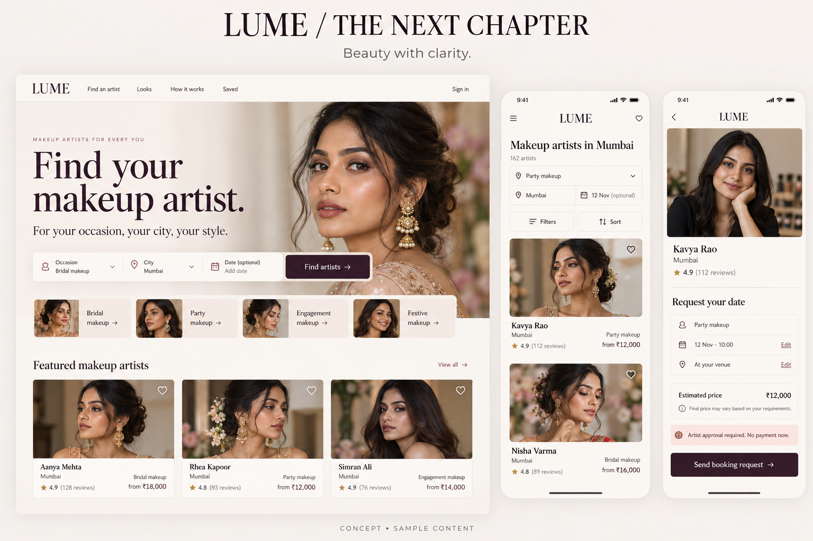
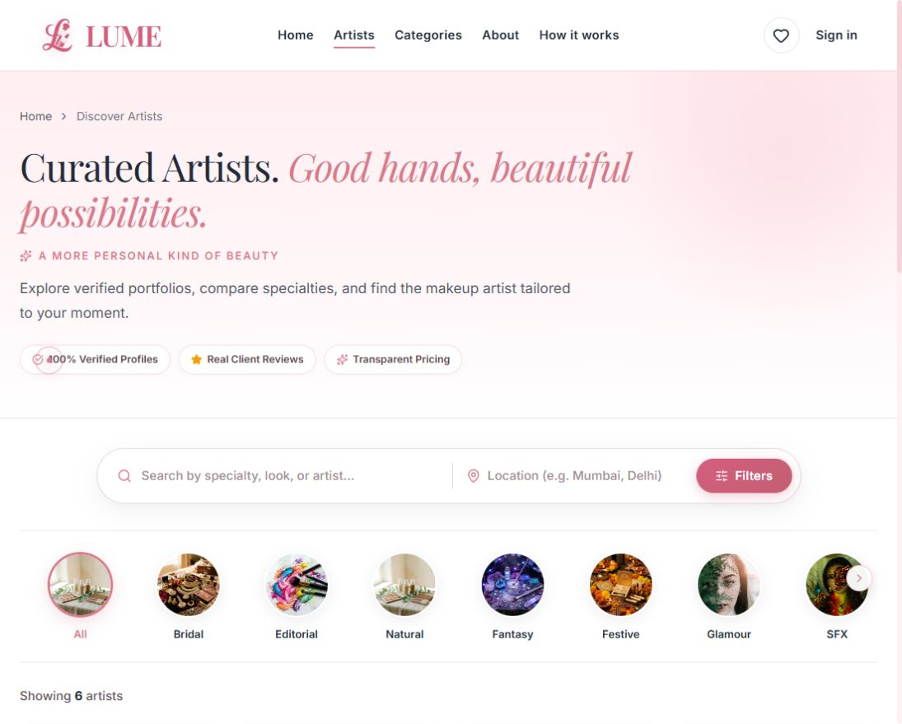
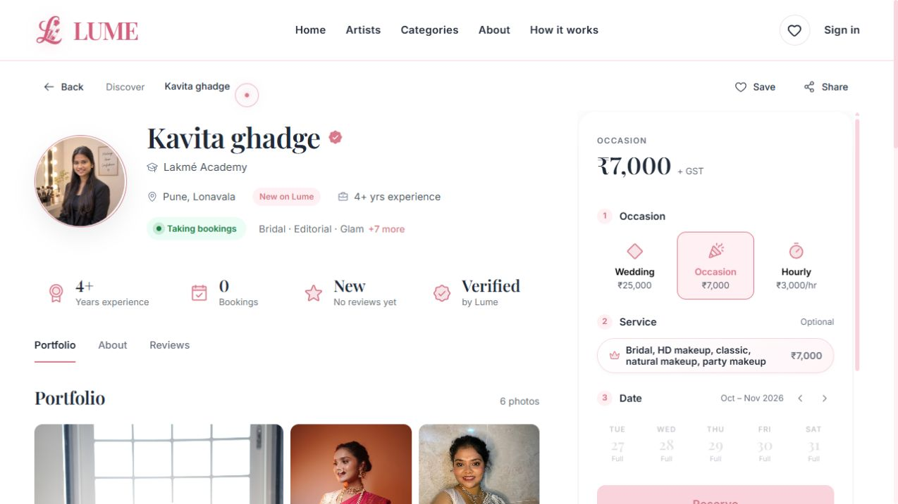
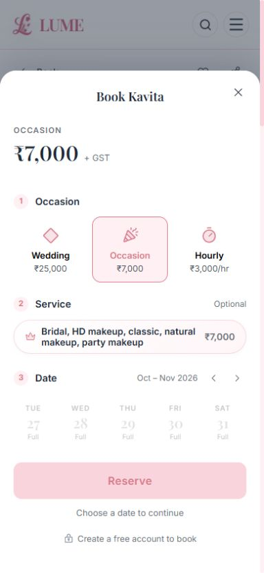
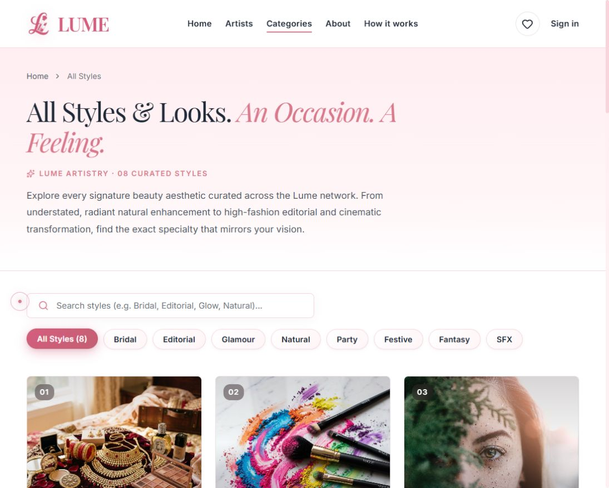
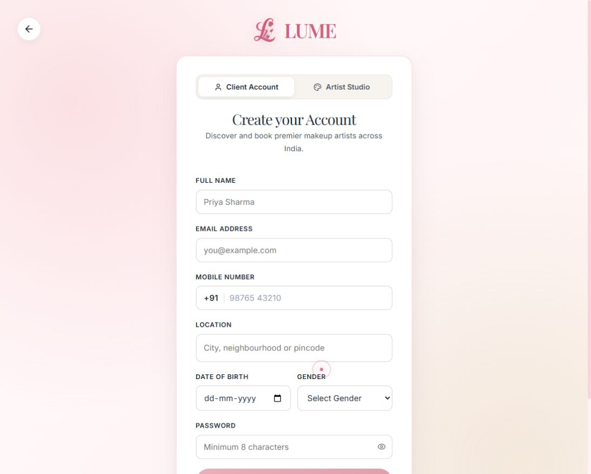
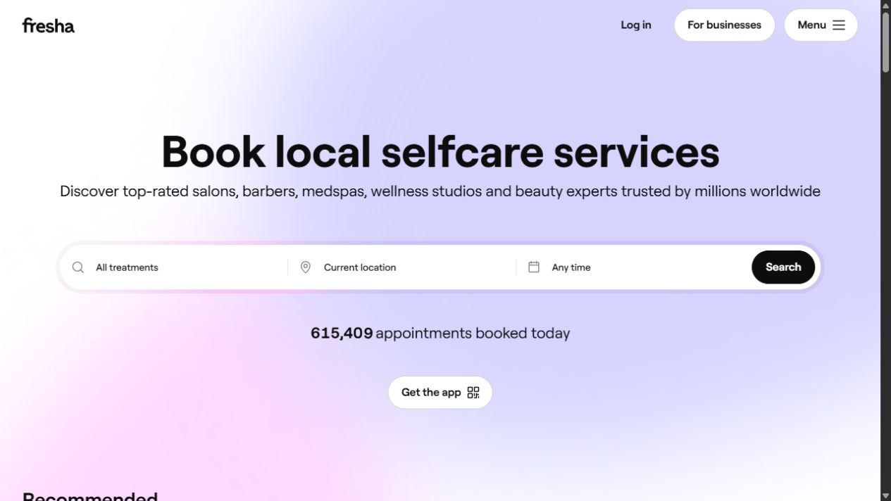
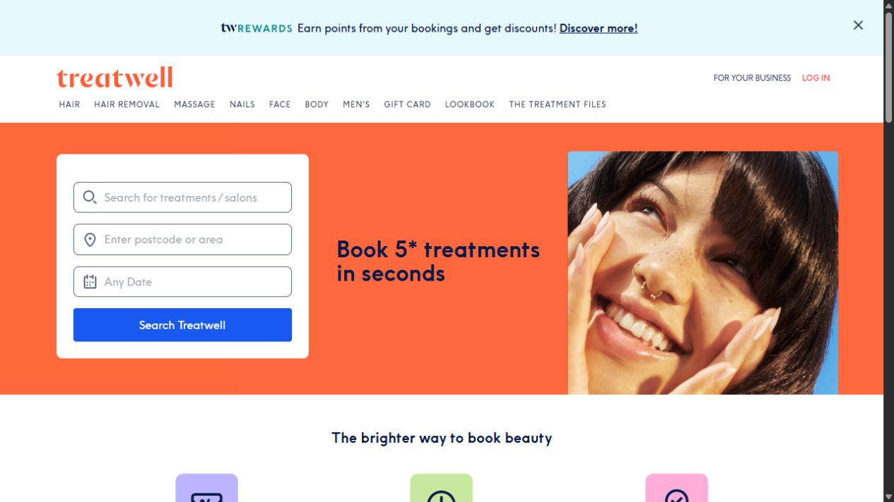
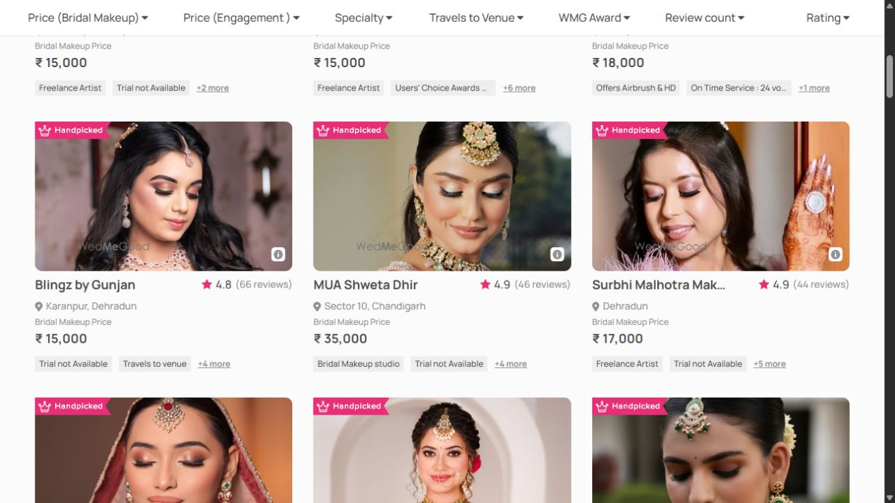

# LUME — UI/UX review & design vision

**26 October 2026 · Proposal for review · Website implementation not started**

## Recommendation

Evolve LUME into a warm, editorial beauty marketplace with a much clearer booking journey. Keep the blush identity, serif headings and focus on individual artists. Spend the first effort on truthful prices, availability, payment states and accessibility; then simplify discovery and apply the visual polish.

The intended feeling is **beauty with clarity**: reassuring, personal and refined. A customer should quickly answer: Does this artist create my look? Do they serve my location? What will the service cost? Can I request my date? What happens after I send the request?

## Review scope and limits

Reviewed the published **https://hellolume.in/** public homepage, discovery/results, filter dialog, an artist profile, categories, sign-in and client registration. Inspected the mobile artist booking sheet at 390 × 844. Reviewed the active route map and local source for saved artists, customer account, payment/confirmation, artist workspace, admin and shared components. These are the website associated with this workspace; no Page was attached to the chat.

**Evidence labels matter:** Live means directly observed on the public site. Source means found in this local checkout, which already contains uncommitted work and can differ from production. Workspace recommendations are source-based, not a claim that the authenticated screens were browser-tested. No accounts, requests or payments were created; no production data was changed. No analytics, user interviews, full assistive-technology audit or measured performance run was available. Treat conversion benefits as hypotheses to validate, not promised uplifts.

## Preserve

- The recognizable LUME name/logo and warm blush character.
- Editorial serif headings paired with practical sans-serif body text.
- Artist individuality, existing portfolio lightbox, genuine review/verification structures and the mobile booking sheet.
- Guest artist browsing and frictionless guest saving.
- The artist-acceptance-before-payment business flow, unless deliberately changed as a separate product decision.

## First decisions

1. **Visual direction:** choose Warm editorial (recommended), Rose continuity or Clean studio.
2. **Service language:** separate occasion from desired look; agree the package/inclusion model.
3. **Booking contract:** agree when a date is held/secured, response guidance, and how changes/cancellations work.
4. **Payment policy:** reconcile the existing 25%/50% advance mismatch and approve one source of truth.
5. **First implementation scope:** prioritize the P0 corrections and one complete customer journey before secondary features.

These are decisions for a subsequent conversation, not approvals already granted.

## Proposed visual direction

| Direction | Look and feel | Trade-off | Recommendation |
|---|---|---|---|
| Warm editorial | Ivory, plum actions, dusty rose details, strong makeup photography, restrained serif headlines | Requires disciplined media selection and component cleanup | Best balance of beauty and booking clarity |
| Rose continuity | Retain today’s pink-forward identity while fixing hierarchy, contrast, forms and spacing | Less visual change; decorative patterns still need restraint | Good if brand continuity is the main constraint |
| Clean studio | White-led, quieter serif use, dark actions and denser results | Fast-scanning utility with a less expressive brand feel | Consider for the artist/admin workspaces |

**Concept limitations:** AI-generated visual exploration, not a functional design or final specification. People, counts, ratings, availability and prices are fictional. The image illustrates layout, palette and hierarchy; it must not supply production reviews, artist work or business promises. The concept’s loose estimated-price note must be replaced with a precise inclusions/fees breakdown before a real request. Real portfolio images require permission and credit.

### Design system proposal

| Element | Proposed rule |
|---|---|
| Palette | Ivory #FBF7F3; plum #35252F for actions/text; dusty rose #AD4968 for accents; champagne only as decoration |
| Typography | Keep Playfair Display for selected headlines and Inter for UI; avoid long italic sentences and all-caps instructions |
| Type scale | Body 16px; labels/secondary copy 14px where practical; screen titles 28–40px; marketing hero 44–64px desktop, 32–40px mobile |
| Layout | Consistent 8px spacing rhythm; 1200px maximum content width; 16–20px phone gutters, 32–48px desktop gutters |
| Controls | Primary action 48px high, field labels always visible, 44–48px practical touch targets; precise selected/focus/error states |
| Surfaces | 12–16px card radii, subtle neutral border, minimal shadows; reserve pills for tags/compact filters |
| Photography | Actual finished looks, inclusive skin tones/ages/styles, natural skin detail, consistent 4:5 portfolio-card crops |
| Motion | 150–200ms feedback where helpful; no forced entry delay; pauseable optional media and reduced-motion behavior |

## Screen-by-screen target

| Screen | Proposed hierarchy | Primary action |
|---|---|---|
| Home | Clear proposition → search → occasions → relevant artists → request process → proof/FAQ | Find artists |
| Discovery | Search criteria → result count + sort → filters → comparable portfolio cards | View artist |
| Looks & occasions | Finished looks → short explanations → relevant artists | Explore artists |
| Artist | Identity + work → packages → location/inclusions → reviews → request panel | Send booking request |
| Request review | Service → date/start time/duration → venue/contact → itemized summary | Send booking request |
| Request status | Truthful state → next expected action → request details → support | View request / Pay after acceptance |
| Saved | Saved artists → common criteria → optional comparison | View artist / Compare |
| Sign-in/register | Essential auth fields → recovery → return to saved booking draft | Continue |
| Customer account | Next appointment → attention needed → history → preferences/settings | Context-specific booking action |
| Artist workspace | Requests → today → awaiting payment → calendar/profile setup | Accept/review request |
| Admin | Action queues → evidence/details → safe intervention → secondary analytics | Review next item |
| About/help/404 | Useful explanation or recovery → relevant route back | Find an artist / Get help |

## Journey and language

**Browse → Filter → Inspect work/packages → Select service/date/time → Sign in if needed, preserving draft → Review → Send request → Await artist → Accepted, payment required → Pay agreed advance/full → Appointment secured → Complete → Review.**

The exact relationship between advance paid and confirmed must be agreed with the existing backend. Do not collapse PARTIALLY_PAID, ACCEPTED and CONFIRMED into one generic success state. Declined, expired, cancelled and payment-verification-pending states need their own next actions.

| Current wording | Suggested wording | Why |
|---|---|---|
| Reserve | Send booking request | Does not imply an already secured appointment |
| Occasion (generic price type) | Name the actual package | Explains what the customer is purchasing |
| From ₹3,000 | Hourly from ₹3,000/hr, or the searched service’s price | Preserves price basis |
| Full when schedule is absent | Availability not published / Could not load availability | Distinguishes unavailability from missing information |
| Booking Requested! | Request sent. We’ll update you when the artist responds. | Gives a truthful next event without inventing an SLA |
| 25% / 50% advance | One configured policy and exact due-now amount | Keeps customer-facing promises aligned |

## Priority and effort key

**P0:** correct before promoting the affected journey: misleading data, payment/booking state, unavailable-date dead end, or major contrast issue. **P1:** core usability/design-system improvement. **P2:** optional polish or later capability.

**S:** small/local change, generally up to 1–2 working days. **M:** several components or states, roughly 3–5 working days. **L:** feature/API/content dependencies, generally a week or more. These are rough implementation sizes per item, not commitments or additive project estimates. Discovery, QA and existing changes can alter them.

## Current-screen evidence

### Current homepage

The main proposition is embedded in campaign imagery; search is near the bottom.

### Current discovery

Intro, search and category circles push the first result below the viewport.

### Current artist profile

Useful profile/gallery foundation, but duplicate stats and an ambiguous booking sidebar.

### Current mobile booking

All displayed dates are Full; Reserve is disabled without an alternative.

### Current categories

Several category images show tools or props rather than finished makeup.

### Current registration

Profile enrichment fields lengthen first-time account creation.

## Detailed recommendations

### Brand & navigation

#### G01 · Keep the identity; simplify the visual system — P1 / M

**Evidence:** Live screens combine blush gradients, pill controls, shadows, sparkles, large serif introductions and several badge styles.

**Change:** Keep the LUME identity, warm neutrals and editorial serif headings. Use deep plum for primary actions, dusty rose for accents, quiet dividers and fewer shadows. Standardize buttons, fields, badges, spacing and card shapes.

**Acceptance:** A shared component sheet covers default, hover, focus, selected, loading, disabled and error states.

**Where checked:** Live public screens; styles/index.css; HomeEditorial.css. **Dependency:** Frontend.

#### G02 · Make navigation describe the task — P1 / S

**Evidence:** The navigation uses Artists and Categories; joining as an artist is mainly a footer action.

**Change:** Use Find an artist, Looks & occasions, How it works, Saved and Account. Keep About in the secondary navigation. Give For artists a clear secondary entry without competing with customer search.

**Acceptance:** A first-time visitor can identify the customer journey and artist entry without opening several pages.

**Where checked:** Live Header and Footer; components/layout/Header.tsx. **Dependency:** Frontend.

#### G03 · Use one search vocabulary everywhere — P1 / M

**Evidence:** Home, header search and Discover use related but different controls. Occasion choices include both events and aesthetics.

**Change:** Share occasion, location and optional date across entry points. Retain selections in the results URL and show editable chips. Keep one location autocomplete and one spelling for each city.

**Acceptance:** Home search, header search, refresh, back and shared URLs reproduce the same criteria.

**Where checked:** LandingPage.tsx; DiscoverPage.tsx; Header.tsx. **Dependency:** Frontend + search API.

#### G04 · Return the standard pointer and native scrolling — P2 / S

**Evidence:** A custom dot/ring cursor runs globally; inertial scrolling is initialized across routes.

**Change:** Use the native pointer and scrolling by default, especially in search, forms and dashboards. Keep restrained hover transitions. If retained, restrict decorative motion to optional marketing experiences.

**Acceptance:** Text selection, wheel scrolling, keyboard navigation and nested dialogs behave predictably.

**Where checked:** components/ui/CustomCursor.tsx; components/layout/SmoothScroll.tsx. **Dependency:** Frontend.

#### G05 · Remove the artificial entry delay — P1 / S

**Evidence:** The preloader fades after 1.2 seconds and is removed at 1.8 seconds on a new session.

**Change:** Render usable content immediately. Reserve skeletons for real data loading; a logo transition should never block search.

**Acceptance:** Search is usable as soon as its controls mount, regardless of image or artist API readiness.

**Where checked:** components/ui/Preloader.tsx. **Dependency:** Frontend.

#### G06 · Provide visible help and policy routes — P1 / M

**Evidence:** The current footer provides contact email but no visible privacy, terms, cancellation or refund links. Artist pages advertise support and free rescheduling.

**Change:** Add readable Help, cancellation/refund, terms and privacy destinations. State actual support channels, hours and response expectations. Publish only operationally supported promises.

**Acceptance:** Policies are reachable before requesting and paying; support contact wording agrees across screens.

**Where checked:** Live Footer; ArtistDetailPage.tsx TRUST_ITEMS; ProfilePage.tsx FAQS. **Dependency:** Content + operations + frontend.

### Homepage

#### H01 · Turn the hero headline into real text — P1 / M

**Evidence:** The visible hero message is part of the slideshow artwork. The inspected home accessibility tree has no main heading; LandingPage renders images without a live h1.

**Change:** Use a real h1: Find your makeup artist. Add: For your occasion, your city, your style. Keep photographs free of baked-in text, with responsive crops and sufficient text contrast.

**Acceptance:** The proposition remains readable with images disabled, at 200% zoom and through a screen reader.

**Where checked:** Live homepage; LandingPage.tsx hero picture elements. **Dependency:** Frontend.

#### H02 · Make the first viewport work harder — P1 / M

**Evidence:** The homepage is dominated by a full-height campaign image; search sits near the bottom of the screen.

**Change:** Use a shorter split hero with the search immediately beside or below the headline. On mobile, place the proposition and search before the supporting image. Reveal the next section without a large empty gap.

**Acceptance:** At 390 × 844, occasion, location and Find artists are visible without scrolling; desktop hints at artist content below.

**Where checked:** Live homepage screenshot; HomeEditorial.css. **Dependency:** Frontend.

#### H03 · Prioritize evidence before brand storytelling — P1 / M

**Evidence:** The page contains artist cards, an about slideshow, occasions, video process cards, FAQs and a moodboard.

**Change:** Use this order: proposition/search → common occasions → relevant artists → three-step request process → real proof → concise FAQ → artist recruitment/footer. Put the longer story on About.

**Acceptance:** Every homepage section answers a distinct booking question and has one meaningful next step.

**Where checked:** Live home section sequence; LandingPage.tsx. **Dependency:** Frontend.

#### H04 · Replace automatic slides with a calm first impression — P2 / S

**Evidence:** The hero rotates every 5 seconds and the About imagery every 4.5 seconds. Process videos rely on hover previews.

**Change:** Prefer one strong hero. If rotation stays, provide pause and navigation controls, stop for reduced motion and avoid changing important copy. Give videos explicit play controls, posters and useful static text.

**Acceptance:** Touch and keyboard users can access the same meaning; no essential instruction requires hover.

**Where checked:** LandingPage.tsx timers and ProcessStepCard. **Dependency:** Frontend + media selection.

#### H05 · Make inspiration links preserve intent — P2 / S

**Evidence:** The moodboard has distinct labels such as The bridal edit and Soft-glam moments, but all inspected links point to the unfiltered directory.

**Change:** Route each edit to matching criteria or a curated collection. Use actual artist work with permission and credit, then connect each look to its artist and relevant service.

**Acceptance:** A Bridal inspiration click opens bridal-relevant results instead of clearing the visitor’s context.

**Where checked:** Live moodboard links; LandingPage.tsx home-moodboard. **Dependency:** Frontend + portfolio metadata.

### Discovery & categories

#### D01 · Bring results into the first screen — P1 / M

**Evidence:** At the reviewed desktop size, the directory introduction, search and large image circles fill almost the entire viewport before artist cards.

**Change:** Use a compact heading such as Makeup artists in Mumbai, then search, a small filter row and results. Keep brand storytelling on the homepage. Use a responsive grid with consistent image ratios.

**Acceptance:** The first result card is visible in the initial desktop viewport; mobile shows a result soon after the search controls.

**Where checked:** Live Discover screenshot; DiscoverPage.css. **Dependency:** Frontend.

#### D02 · Separate sort from filters — P1 / M

**Evidence:** The Filters dialog opens on Sort By and uses a two-pane hierarchy for sort, budget, location and experience.

**Change:** Expose Sort as a simple control next to the result count. Keep price, verification and experience in Filters with selected-state chips and Clear all. Use a single-column sheet on phones.

**Acceptance:** Users can change sort directly and identify/remove each active filter without reopening multiple tabs.

**Where checked:** Live Filters drawer; DiscoverPage.tsx. **Dependency:** Frontend.

#### D03 · Support event-first search with useful refinements — P1 / L

**Evidence:** The search currently mixes Bridal, Party and Festive with Natural, Glamour, Editorial, Fantasy and SFX.

**Change:** Separate Occasion from Look/style. Add studio versus at-venue, travel area, hair/draping inclusions, trials and date availability only where structured data supports them. Start with the refinements customers actually need.

**Acceptance:** Bridal + Natural can coexist. Unsupported availability or travel filters are never presented as working.

**Where checked:** Live categories; DiscoverPage.tsx DISCOVER_CATEGORIES. **Dependency:** Taxonomy + artist onboarding + API.

#### D04 · Label starting prices with their service and unit — P0 / M

**Evidence:** The inspected artist card says From ₹3,000, while the profile defaults to Occasion ₹7,000; ₹3,000 is the hourly rate.

**Change:** Display Hourly from ₹3,000/hr or Bridal from ₹25,000 as appropriate. Match the card to the searched occasion. Keep the selected basis and tax/fee disclosure consistent through the summary.

**Acceptance:** A card-to-profile transition never changes the apparent price without naming the different service or unit.

**Where checked:** Live Kavita card and profile; DiscoverPage.tsx; ArtistDetailPage.tsx. **Dependency:** Frontend + normalized pricing data.

#### D05 · Make cards comparable and truthful — P1 / M

**Evidence:** Live cards foreground a photo, Pro tag, several specialties, location and a generic starting price.

**Change:** Use actual portfolio work as the lead image with a separate artist avatar. Standardize name, city/service area, requested service price, verified status and rating + review count. Use New on LUME for unrated artists and explain any Pro label.

**Acceptance:** Three cards can be compared on the same facts; no missing rating appears as a fabricated score.

**Where checked:** Live result cards; ArtistCard.tsx; DiscoverPage.tsx. **Dependency:** Frontend + media and listing data.

#### D06 · Give categories visual meaning — P1 / M

**Evidence:** Bridal uses a jewellery still life, Editorial uses coloured powders and Natural uses a vanity scene; these do not directly show the finished makeup result.

**Change:** Use recognizably different finished looks, consistent portrait crops and descriptive alt text. Reduce each category description to a useful sentence, typical inclusions and Explore artists. For eight options, prioritize browsing over a prominent search field.

**Acceptance:** A person can visually distinguish Natural, Glamour and Bridal without reading a long paragraph.

**Where checked:** Live Categories screenshot; CategoriesPage.tsx. **Dependency:** Photography selection + content.

#### D07 · Preserve results and handle slow searches — P1 / M

**Evidence:** Discover fetches whenever the free-text query changes; the request shown in source has no cancellation or debouncing.

**Change:** Debounce text queries, cancel stale requests, retain previous results during refresh and announce the result count. Distinguish no match from server error; offer remove-a-filter, change-city and Retry actions.

**Acceptance:** Fast typing cannot let an older response replace the newest query; failures retain criteria and allow recovery.

**Where checked:** DiscoverPage.tsx fetch effect and filter state. **Dependency:** Frontend + API response design.

### Artist profile

#### A01 · Lead with work and the facts needed to choose — P1 / M

**Evidence:** The profile has a large identity/stats area with repeated verification and experience; Portfolio begins lower down.

**Change:** Show a compact identity row and strong portfolio gallery early. Include location, verification meaning, real review count and service starting price once. Keep section anchors for Portfolio, Services, About and Reviews.

**Acceptance:** The first viewport shows both finished work and a clear path to reviewing services.

**Where checked:** Live profile screenshot; ArtistDetailPage.tsx. **Dependency:** Frontend.

#### A02 · Explain unavailable dates instead of a dead end — P0 / L

**Evidence:** The inspected profile says Taking bookings, but all 30 displayed dates are disabled and labelled Full. Source also maps zero available slots to Full.

**Change:** Distinguish booked, day off, schedule not published, loading and availability unavailable. Offer Next available date, later-month browsing or other artists. Offer an availability enquiry only if the operational workflow exists.

**Acceptance:** A missing/failed schedule is never labelled fully booked; every no-date state has an honest next step.

**Where checked:** Live desktop/mobile profile; ArtistDetailPage.tsx upcomingDates and slotCountFor. **Dependency:** Availability API + artist calendar + frontend.

#### A03 · Replace ambiguous occasion/service selection — P1 / L

**Evidence:** The booking card offers Wedding, Occasion and Hourly, then an optional service chip that combines several services into one long title.

**Change:** Present clear packages such as Bridal makeup + hair, Party makeup and Hourly session, each with duration, inclusions, exclusions and price basis. Keep add-ons separate and show how each selection changes the total.

**Acceptance:** The selected service, duration and price in the summary match what the booking API will create.

**Where checked:** Live profile booking card; ArtistDetailPage.tsx; artist/ArtistProfile.tsx. **Dependency:** Service data model + API + artist editor.

#### A04 · Make time selection match appointment duration — P1 / M

**Evidence:** The source displays one-hour time buttons and allows multiple selections; readiness only checks for at least one selected slot.

**Change:** For a fixed package, ask for a start time and derive its duration/end time. For hourly work, explain minimum hours and require a valid contiguous block. Include travel/preparation buffers where supported.

**Acceptance:** The interface cannot promise an appointment length that the schedule cannot accommodate.

**Where checked:** ArtistDetailPage.tsx availableSlots, selectedTimeSlots and isBookingReady. **Dependency:** Scheduling rules + backend validation.

#### A05 · Add decision-making portfolio and review context — P1 / M

**Evidence:** Portfolio photos can open in a lightbox and reviews show an aggregate. Existing basic structures are useful.

**Change:** Add look/service captions and occasion tags, accessible previous/next controls, optional video controls and keyboard support. For reviews, show service/date context and verified appointment status only when backed by data. Avoid retouching that hides actual finish.

**Acceptance:** Visitors can identify work relevant to their occasion and understand the evidence behind a review badge.

**Where checked:** Live profile portfolio/reviews; ArtistDetailPage.tsx. **Dependency:** Frontend + media/review metadata.

#### A06 · State what verification and guarantees cover — P1 / S

**Evidence:** The profile shows Verified by Lume alongside Vetted Artists, 24/7 Support and Free Reschedule messages.

**Change:** Explain what was checked, separate identity/portfolio review from customer satisfaction, and link any protection or rescheduling promise to its actual conditions. Use one concise trust section.

**Acceptance:** Every badge has an understandable definition; no unsupported response-time or refund promise appears.

**Where checked:** Live profile; ArtistDetailPage.tsx TRUST_ITEMS. **Dependency:** Operations-approved content.

### Booking & payment

#### B01 · Name the request and confirmation stages accurately — P0 / M

**Evidence:** The main CTA says Reserve, the success modal says Booking Requested, and separate confirmation code maps every non-PENDING status to confirmed wording.

**Change:** Use Send booking request before acceptance. Show Request sent → Awaiting artist → Accepted, payment needed → Advance paid / Confirmed → Completed, with declined, expired and cancelled branches. Agree exactly when the date is secured.

**Acceptance:** Every backend status maps explicitly to customer and artist language; accepted-but-unpaid is never labelled confirmed.

**Where checked:** ArtistDetailPage.tsx; BookingConfirmPage.tsx; payments.controller.ts. **Dependency:** Product policy + shared status mapping + backend.

#### B02 · Resolve conflicting advance-payment promises — P0 / M

**Evidence:** Profile FAQ says 25% advance. PaymentOptionsModal and the payment controller calculate 50%. The FAQ also promises escrow and instant refunds.

**Change:** Choose the actual business rule and source the percentage, amounts and policy text centrally. Show service total, applicable taxes/fees, amount due now and balance due later before payment. Verify all escrow/refund claims with operations.

**Acceptance:** FAQ, payment dialog, email, receipt and backend order agree for advance, full and remaining payments.

**Where checked:** ProfilePage.tsx FAQS; PaymentOptionsModal.tsx; payments.controller.ts. **Dependency:** Business rule + server quote + content.

#### B03 · Provide a review step with clear edits — P1 / M

**Evidence:** The profile places occasion, optional service, date, time and optional details in one long booking surface.

**Change:** Group into Service → Date & time → Venue & contact → Review request. Keep a running summary on desktop and sticky next action on mobile. Make venue/contact requirements conditional on service mode, and preserve edits and validation errors.

**Acceptance:** Before submission, the customer sees artist, service, duration, location, estimate and No payment now with an Edit action for each group.

**Where checked:** ArtistDetailPage.tsx booking aside and mobile sheet. **Dependency:** Frontend + required-field rules.

#### B04 · Make payment recovery safe and understandable — P1 / L

**Evidence:** The payment modal has loading and error text, but verification failure asks the customer to contact support.

**Change:** Show processing, cancelled, failed, verification pending and successful outcomes separately. Reconcile the server payment state before inviting another payment. Keep the booking reference and a clear support route visible.

**Acceptance:** A successful charge with a delayed verification is shown as pending verification, not a prompt to immediately pay again.

**Where checked:** components/payment/PaymentOptionsModal.tsx. **Dependency:** Payment reconciliation API + frontend.

#### B05 · Give post-request screens an actionable next step — P1 / M

**Evidence:** BookingConfirmPage reads currentBooking from session storage and mainly offers Back to Home; the profile also has a separate request-success modal.

**Change:** Unify the receipt/status destination with View request, the next expected event and actual response guidance. Load bookings by an authorized reference so refresh or a new tab does not lose the status. Add calendar export only once the appointment is secured.

**Acceptance:** Refreshing an authorized booking URL retains its truthful state and available next actions.

**Where checked:** BookingConfirmPage.tsx; ArtistDetailPage.tsx success modal. **Dependency:** Booking detail route/API + frontend.

### Saved artists

#### S01 · Distinguish an empty shortlist from a loading failure — P1 / M

**Evidence:** SavedPage catches an API failure by assigning an empty array and fetches the first 100 artists before filtering saved IDs.

**Change:** Show Your shortlist is empty only for genuinely empty saved IDs. Show a recoverable error for failed loads and unavailable placeholders for removed artists. Fetch saved IDs directly so older artists do not disappear behind a list limit.

**Acceptance:** Saved items survive a transient error and artists outside the first 100 results remain retrievable.

**Where checked:** SavedPage.tsx fetch effect; hooks/useFavorites.ts. **Dependency:** Saved-ID API + frontend.

#### S02 · Offer a small useful comparison — P2 / L

**Evidence:** The page promises review and compare but mainly displays saved artist cards.

**Change:** Allow comparing up to three artists on the same selected service, price basis, city/travel, review count, inclusions and availability when verified. Keep Compare optional until listing data is consistent.

**Acceptance:** Comparison uses equivalent services and has a readable stacked layout on mobile.

**Where checked:** SavedPage.tsx copy and cards. **Dependency:** Structured services + availability data.

#### S03 · Explain where a shortlist is saved — P2 / L

**Evidence:** Favorites are stored in browser local storage rather than a connected account.

**Change:** Keep guest saving frictionless with a Saved confirmation and Undo for removal. Explain device-only storage until account synchronization exists; then merge guest saves on sign-in.

**Acceptance:** The product never promises cross-device saving until it is implemented; removal is easy to undo.

**Where checked:** hooks/useFavorites.ts; SavedPage.tsx. **Dependency:** Frontend; account sync needs backend.

### Sign-in & registration

#### U01 · Ask for fewer details before the first request — P1 / M

**Evidence:** Client registration displays name, email, phone, location, date of birth, gender and password in one form; optional fields are not clearly distinguished.

**Change:** Begin with the authentication details actually required. Collect contact and venue at booking; make DOB/gender optional profile enrichment only when there is a stated purpose. Separate the longer artist onboarding from basic account creation.

**Acceptance:** A new customer can create an account without completing unrelated profile fields; optionality is explicit.

**Where checked:** Live registration; auth/RegisterPage.tsx. **Dependency:** Frontend + authentication validation policy.

#### U02 · Return people to their booking after authentication — P1 / M

**Evidence:** Unauthenticated booking redirects to /login; a client login then navigates to /home, and booking selections live in component state.

**Change:** Retain the artist, service, date, time and non-sensitive draft choices; use a return destination after successful sign-in. Recheck availability before final submission and never auto-submit a restored request.

**Acceptance:** Signing in midway returns to the same request review with any changed availability explained.

**Where checked:** ArtistDetailPage.tsx handleBookingConfirm; auth/LoginPage.tsx. **Dependency:** Frontend + draft lifetime rules.

#### U03 · Provide account recovery and honest sign-in choices — P1 / L

**Evidence:** The inspected public sign-in screen has no Forgot password link. The source includes a conditional Google button which did not appear in the public screen reviewed.

**Change:** Add an accessible recovery flow and clear email delivery/retry states. Present Google sign-in only when configured and working. Route returning users using their account role rather than requiring them to guess a tab.

**Acceptance:** A customer can recover access and return to the intended task; advertised sign-in methods are configured.

**Where checked:** Live Login; auth/LoginPage.tsx; GoogleAuthButton.tsx. **Dependency:** Recovery endpoints + auth provider configuration.

#### U04 · Fix field labels and password controls — P1 / S

**Evidence:** Several auth inputs are exposed without names in the live accessibility tree; source labels lack htmlFor/id pairing and eye buttons lack descriptive names.

**Change:** Connect every label to its field, add suitable autocomplete/input modes and visible password requirements, name the show/hide action, and connect inline errors to their inputs.

**Acceptance:** A screen reader announces each field, optional/required status and validation message; keyboard submission works.

**Where checked:** Live auth accessibility trees; LoginPage.tsx; RegisterPage.tsx. **Dependency:** Frontend.

### Customer account

#### P01 · Make appointments the account’s primary job — P1 / M

**Evidence:** ProfilePage combines bookings, saved artists, addresses, preferences, account settings and help.

**Change:** Lead with the next appointment and actions requiring attention. Separate Upcoming, Awaiting artist/payment and Past. Use compact booking cards with one primary action, a timeline and visible support access.

**Acceptance:** A returning customer can find an accepted request needing payment without searching through settings.

**Where checked:** ProfilePage.tsx; source review only. **Dependency:** Frontend.

#### P02 · Remove invented personal defaults — P0 / M

**Evidence:** Source initializes a sample Mumbai address, sample phone number and preselected beauty preferences for an empty account.

**Change:** Start personal data empty. Use Add your venue and optional preference setup, with clear save feedback. Distinguish data saved on this device from account-backed information.

**Acceptance:** A new account never appears to own a fictional address, phone number or skin preference.

**Where checked:** ProfilePage.tsx DEFAULT_ADDRESSES and DEFAULT_PREFERENCES. **Dependency:** Frontend; account persistence may need API.

#### P03 · Make changes and cancellations trackable — P1 / L

**Evidence:** FAQ copy suggests coordinating rescheduling directly, but does not establish a single visible request/state contract.

**Change:** Show available changes, applicable conditions, outstanding balance and the status of any reschedule or cancellation request in booking details. Distinguish requested changes from accepted changes and refunds requested from completed.

**Acceptance:** Both parties see the same agreed date and status; policy conditions are visible before confirming a change.

**Where checked:** ProfilePage.tsx FAQS and booking UI; source review only. **Dependency:** Operations rules + booking change APIs.

#### P04 · Keep receipts, payments and support together — P1 / M

**Evidence:** Payment, invoice and help tools exist across the account, but booking and payment terminology is inconsistent.

**Change:** Use one booking-detail hub showing service total, paid amount, balance, payment events, receipt links and support reference. Keep optional beauty preferences lightweight and editable.

**Acceptance:** Paid to date never looks like total service price; every payment action relates to a clear booking reference.

**Where checked:** ProfilePage.tsx; BookingSummary.tsx; PaymentOptionsModal.tsx. **Dependency:** Shared booking/payment data contract.

### Artist workspace

#### R01 · Lead the dashboard with work requiring action — P1 / M

**Evidence:** ArtistDashboard includes an itinerary, statistics and workspace actions; authenticated visual behavior was not tested.

**Change:** Prioritize pending requests, today’s appointments, awaiting-payment bookings and profile/schedule setup. Include a preview of the public profile and explain unpublished or paused states.

**Acceptance:** A new artist sees the next setup action; an active artist sees the next booking action first.

**Where checked:** artist/ArtistDashboard.tsx; source review only. **Dependency:** Frontend.

#### R02 · Make service and portfolio setup progressive — P1 / L

**Evidence:** ArtistProfile contains portrait, studio information, standard event rates, custom services and portfolio editing on a long page.

**Change:** Use grouped steps with draft saving, explicit required fields, image upload progress/crop/reorder, service inclusions and a public preview. Explain review pending, approved, changes requested and which edits are live.

**Acceptance:** An interrupted upload or pending verification does not discard work or misrepresent what customers can see.

**Where checked:** artist/ArtistProfile.tsx; source review only. **Dependency:** Upload workflow + verification API + frontend.

#### R03 · Make calendar setup prevent customer dead ends — P1 / L

**Evidence:** The calendar supports weekly templates and date exceptions. Its current-rate text uses a dollar sign in an otherwise INR product.

**Change:** Use INR throughout. Distinguish working hours, booked time, exceptions and unpublished schedules. Support copy-to-days, buffers and a customer-view preview. Warn before pausing/changing hours that affect existing bookings.

**Acceptance:** Artists can tell which dates customers can actually request; changed availability does not silently invalidate appointments.

**Where checked:** artist/ArtistCalendar.tsx; source review only. **Dependency:** Scheduling API + dependency checks.

#### R04 · Include advance-paid bookings in the artist’s work list — P0 / M

**Evidence:** ArtistBookings upcoming filter includes ACCEPTED and CONFIRMED but excludes PARTIALLY_PAID. The payment controller sets PARTIALLY_PAID after an advance.

**Change:** Use a shared booking-state map and include advance-paid appointments in the correct upcoming/payment groups. Display deposited amount and balance with clear labels; keep actions appropriate to each state.

**Acceptance:** An advance-paid future appointment remains visible and actionable in the artist workspace.

**Where checked:** artist/ArtistBookings.tsx upcomingBookings; payments.controller.ts ADVANCE update. **Dependency:** Shared domain state mapping + frontend.

#### R05 · Replace hardcoded performance claims with data — P0 / M

**Evidence:** ArtistRatings hardcodes 100% completion, Top tier reliability, Active search boost and Featured in Top Picks.

**Change:** Compute only supported metrics with clear definitions and periods. Show Not enough data for a new artist. Remove ranking/boost promises unless the system actually implements them.

**Acceptance:** No performance or promotion badge appears without a corresponding real data source and rule.

**Where checked:** artist/ArtistRatings.tsx; source review only. **Dependency:** Analytics data + ranking policy.

#### R06 · Use consistent action feedback and settings groups — P2 / M

**Evidence:** Booking failures can use browser alert, declines use window.confirm, and settings span studio policies, notifications and account details.

**Change:** Use contextual error/success feedback, a clear decline reason flow, and grouped settings with Save/Cancel and unsaved-change protection. Keep destructive account actions distinct and confirm their impact.

**Acceptance:** Every operation communicates progress and outcome; changing tabs cannot silently lose edits.

**Where checked:** artist/ArtistBookings.tsx; artist/ArtistSettings.tsx. **Dependency:** Frontend + action audit/reason support.

### Admin workspace

#### X01 · Prioritize operational queues — P1 / M

**Evidence:** AdminDashboard includes overview charts, artists, clients, payments and activity; no authenticated browser review was performed.

**Change:** Lead with pending verification, failed payouts and bookings needing intervention. Provide explicit queue counts, age, filters and an assigned next action; keep broader charts secondary.

**Acceptance:** An operator can identify and open the oldest actionable item without interpreting several charts.

**Where checked:** admin/AdminDashboard.tsx; source review only. **Dependency:** Queue data + frontend.

#### X02 · Make verification decisions explainable — P1 / L

**Evidence:** The admin modal supports profile details, verification/rejection, edit approval and booking overrides.

**Change:** Show submitted evidence beside public-preview content, differences between current and proposed data, rejection reasons and an action history. Keep payout/booking interventions visibly separate from routine profile editing.

**Acceptance:** A decision records what changed and why; the artist receives actionable next steps from supported workflows.

**Where checked:** admin/AdminDashboard.tsx; source review only. **Dependency:** Review/audit API + frontend.

#### X03 · Separate financial amounts and statuses — P1 / M

**Evidence:** The console includes payment summaries, bank details, payment records and payout actions.

**Change:** Use clear columns for service value, customer payment, refunds, platform share and artist payout; show date range and currency. Use status-specific actions and a confirmation summary for consequential changes.

**Acceptance:** An operator can distinguish money collected from money paid out and see the effect before confirming an action.

**Where checked:** admin/AdminDashboard.tsx payment workspace; source review only. **Dependency:** Finance data definitions + frontend.

### Accessibility & quality

#### Q01 · Correct the color contrast assumptions — P0 / M

**Evidence:** accessibility.css comments claim white on #D97A8C is 5:1. The calculated solid-color contrast is about 2.95:1; white on #F2A4B0 is about 1.96:1.

**Change:** Audit actual rendered text/control pairs, gradients and selected states. Use dark plum for main actions or a darker rose. Proposed white on #AD4968 is about 5.34:1; white on #35252F is about 14.41:1.

**Acceptance:** Normal text reaches 4.5:1 and applicable large text/non-text controls 3:1. Test rendered states rather than relying on comments.

**Where checked:** styles/accessibility.css; calculated WCAG sRGB luminance; W3C quick reference. **Dependency:** Frontend.

#### Q02 · Complete keyboard and dialog behavior — P1 / M

**Evidence:** Dialogs generally have labels and Escape handlers, but consistent focus trapping/return is not established across all customer dialogs. A SkipLink component exists but is not mounted in the inspected App.

**Change:** Make dialogs focus-contained with initial focus, Escape and focus return. Add a skip link, logical headings, accessible calendars, selected states, useful alt text and announced errors/results. Prevent sticky bars from hiding focused controls.

**Acceptance:** Browse → filter → profile → request is keyboard-completable; 200% zoom and a screen-reader pass reveal no lost content.

**Where checked:** App.tsx; Header.tsx; DiscoverPage.tsx; ArtistDetailPage.tsx. **Dependency:** Frontend + manual accessibility QA.

#### Q03 · Design mobile states deliberately — P1 / M

**Evidence:** The mobile booking sheet exists and opens correctly in the reviewed public profile; it still exposes a long form and tiny disabled date labels.

**Change:** Use 44–48px touch targets as the product goal, readable secondary text, safe-area padding and a sticky action/summary. Account for the on-screen keyboard, long artist names, landscape and empty/error states.

**Acceptance:** Test 360, 390, 768, 1024 and 1440px layouts; no horizontal overflow, covered actions or trapped nested scrolling.

**Where checked:** Live 390 × 844 booking sheet; responsive styles. **Dependency:** Frontend.

#### Q04 · Reduce media cost and measure actual speed — P1 / M

**Evidence:** The first five desktop slideshow PNGs total about 8.88 MB. Source preloads slideshow/About imagery. No Lighthouse or real-user speed score was measured.

**Change:** Serve responsive AVIF/WebP, prioritize one hero, defer offscreen media, reserve image dimensions and avoid unnecessary eager preloads. Measure homepage, results and profile on realistic mobile connections.

**Acceptance:** Track LCP ≤2.5s, INP ≤200ms and CLS ≤0.1 at the 75th percentile; these are targets, not claimed current results.

**Where checked:** public/slideshow/1–5.png file sizes; LandingPage.tsx preload effect; Google Core Web Vitals. **Dependency:** Media pipeline + frontend + measurement.

#### Q05 · Make loading, empty and offline states actionable — P1 / M

**Evidence:** Different routes use skeletons, blank auth guards, error messages and empty lists with different recovery behavior.

**Change:** Create shared state patterns: loading with a stable layout; no matching results with edits; true empty account with a next step; error with Retry; offline with clear limits. Keep forms and filters intact after recoverable failures.

**Acceptance:** A network failure never looks like zero saved artists, all dates booked or an account with no appointments.

**Where checked:** App.tsx guard loading; SavedPage.tsx; DiscoverPage.tsx; ArtistDetailPage.tsx. **Dependency:** Frontend.

#### Q06 · Make About, help and not-found pages useful — P2 / M

**Evidence:** About and NotFound routes exist; the public site emphasizes broad platform storytelling and trust language.

**Change:** Use About to explain curation, service area and people behind LUME. Give FAQs direct policy links and concise answers. A 404 should offer search, artist discovery and preserved navigation, while distinguishing a removed artist from a bad URL.

**Acceptance:** Every secondary page provides a useful route back to the customer task and uses the same supported policies.

**Where checked:** AboutPage.tsx; NotFound.tsx; Footer.tsx. **Dependency:** Content + frontend.

#### Q07 · Improve shareability and search previews — P2 / M

**Evidence:** The public pages reviewed use the same general title; routes have artist-specific content and the local source is adding readable slugs.

**Change:** Add unique page titles/descriptions, actual live h1 text, canonical routes and relevant social-preview images. Use structured artist/service information only when accurate; keep personal booking/account pages out of public indexing.

**Acceptance:** Sharing an artist produces the correct artist preview, and category/search URLs retain meaningful context.

**Where checked:** Live page titles; App.tsx; ArtistDetailPage.tsx slug handling. **Dependency:** Metadata/rendering strategy + frontend.

## Delivery sequence to consider

**Stage 1 — Truth and continuity.** Resolve price labels, advance/payment policy, state mappings, schedule recovery, fictional defaults, hardcoded metrics, contrast and interrupted sign-in. Requires business rules as well as frontend work. Exit when a customer and artist agree on service, amount and status through an advance-paid appointment.

**Stage 2 — The customer journey.** Build a shared component sheet, then redesign Home → Discover → Artist → Request review/status and Saved in desktop and mobile. Use real approved media and all loading/empty/error states. Exit with one coherent end-to-end prototype and verified implementation of the approved scope.

**Stage 3 — Workspaces and operations.** Apply the same state model to customer appointments, artist setup/calendar/requests and admin queues. Validate with real authorized test accounts and representative non-production records.

**Stage 4 — Optional differentiation.** Add comparison, cross-device shortlists, richer look collections and other refinements only after the underlying data and journey are reliable. A map view, reels feed, AI matching quiz, chat system or broad rebrand should not displace the earlier work without evidence of user need.

## Validation plan and success measures

Run a small formative round with about five prospective customers and three working artists; recruit a mix of device experience and makeup occasions. This is a recommended research plan, not research already completed. Ask customers to find a relevant artist within a budget, explain an hourly versus package price, recover from no availability, submit a draft request, and identify the next step after acceptance. Ask artists to publish a service, set exceptions and locate an advance-paid appointment.

Track the funnel separately: search submitted → result opened → service chosen → request started → sign-in completed → request sent → artist accepted → payment verified. Also record no-result searches, unavailable-date exits, request-form errors, payment-verification delays and support questions about price/status. Establish baselines first; do not attach invented percentage improvements to a redesign.

Check layouts at 360/390/768/1024/1440px, keyboard-only use, 200% zoom, a screen reader, reduced motion, slow/offline requests, long names, no reviews, missing images and delayed payment confirmation. Core Web Vitals targets are LCP ≤2.5s, INP ≤200ms and CLS ≤0.1 at the 75th percentile, per Google guidance. No current score was measured in this review.

For accessibility, use WCAG 2.2 AA as the target: applicable normal-text contrast 4.5:1, large-text contrast 3:1, visible keyboard focus, labels/errors and reflow. Aim for 44–48px touch controls as the product standard; WCAG 2.2 AA’s minimum target-size criterion is 24 × 24 CSS px with defined exceptions, not a blanket 44px rule.

## Reference notes

Reference screenshots were captured from public websites on 26 October 2026. They are comparison material; their images, identities and performance claims are not assets to reuse in LUME. Their value here is the identified interface pattern, not an assertion that the whole reference experience is superior.

- [Fresha](https://www.fresha.com/): dominant service/location/time search and clear separation of customer versus business entry.
- [Treatwell](https://www.treatwell.co.uk/): a direct service/area/date form beside beauty imagery; adapt the clarity with LUME’s own visual language.
- [WedMeGood bridal makeup](https://www.wedmegood.com/vendors/all/bridal-makeup/): India-specific service price labels, review counts, trials and travel context.
- [W3C WCAG 2.2 quick reference](https://www.w3.org/WAI/WCAG22/quickref/): accessibility criteria, including contrast, labels, focus and target size.
- [Google Core Web Vitals guidance](https://developers.google.com/search/docs/appearance/core-web-vitals): loading, interaction and stability measurement targets.

## What has been delivered

This folder contains the visual review in **index.html**, this written audit, **findings.json** for the prioritized backlog, current-screen evidence and three reference screenshots, plus a generated concept image and its full prompt. The HTML review lets you record a local preference per recommendation and export those preferences. These are planning notes, not executable approvals or changes to the website.

Only this documentation folder was created. Existing application files and uncommitted work were left intact. The generated concept used the built-in image generation tool; its exact prompt is saved in **vision-prompt.txt**.

### Fresha screenshot

Take: Service + location + time are grouped into one dominant search action. Adapt: Use occasion + city + optional date. Preserve LUME’s beauty identity and request-before-payment model. Avoid: Do not borrow platform-scale booking counts or instant-booking claims.

### Treatwell screenshot

Take: The first screen pairs beauty imagery with a plainly labeled service, area and date form. Adapt: Use a compact mobile form and a strong primary search action. Avoid: Do not import discount-heavy merchandising or a salon-only service structure.

### WedMeGood bridal directory screenshot

Take: Cards state bridal makeup price, review count, location and practical details such as trials/travel. Adapt: Make Indian occasion pricing and service inclusions equally explicit, with a calmer card hierarchy. Avoid: Do not replicate dense badges, unrelated vendor navigation or other artists’ photos.
